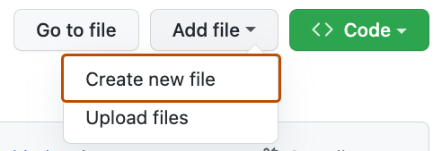

# Markdown Format Examples

This file shows common Markdown elements: headers, links, lists, images, code, and tables.

---

## Headers

# H1
## H2
### H3
#### H4

---

## Links

- Inline link: [GitHub](https://github.com)
- Link with title: [OpenAI](https://openai.com "OpenAI website")
- Reference-style link: [Profile][profile]

[profile]: https://github.com/your-username

---

## Lists

Unordered list:

- Item A
- Item B
  - Nested B.1
  - Nested B.2
- Item C

Ordered list:

1. First
2. Second
   1. Sub-second.a
   2. Sub-second.b
3. Third

Checklist:

- [x] Completed
- [ ] Open

---

## Images

Inline image (relative path to this repo's images folder):



---

## Code

Inline code: Use `git status` to check repository state.

Code block (bash):

```bash
# clone a repository
git clone https://github.com/owner/repo.git
```

Code block (python):

```python
def greet(name):
    return f"Hello, {name}!"
```

---

## Blockquote

> This is a blockquote. Use it for quoting text or highlighting an important note.

---

## Table

| Feature       | Syntax       | Example |
|---------------|--------------|---------|
| Header        | `# H1`       | `# Title` |
| Link          | `[text](url)`| `[GitHub](https://github.com)` |

---

## Tips

- Use headings to structure content.
- Keep links descriptive.
- Prefer fenced code blocks for readability.

